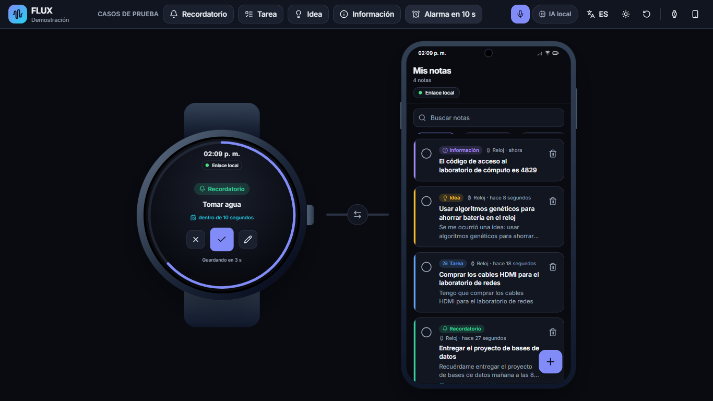
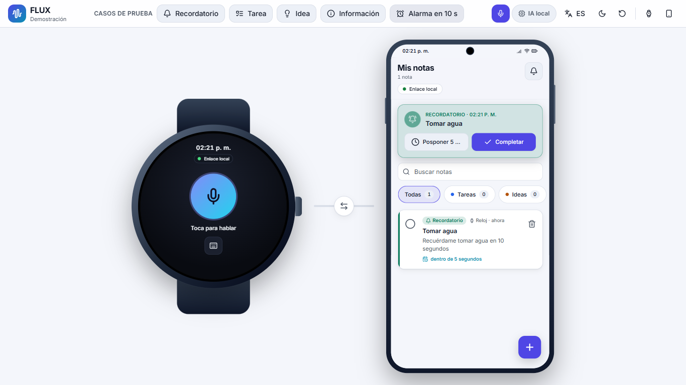
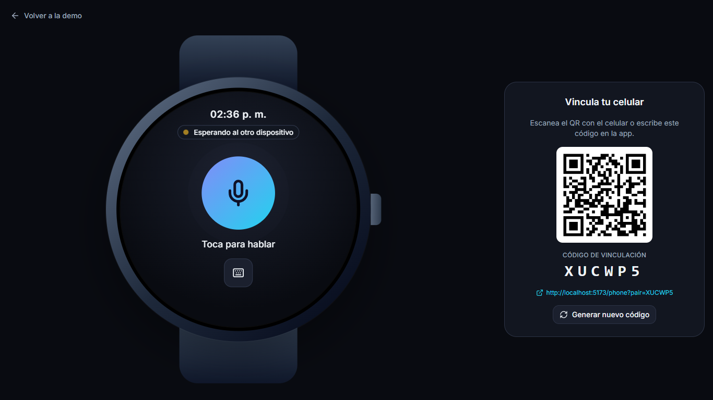
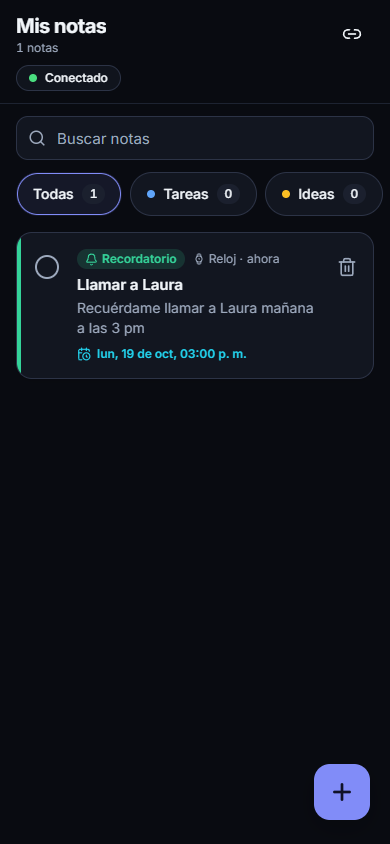
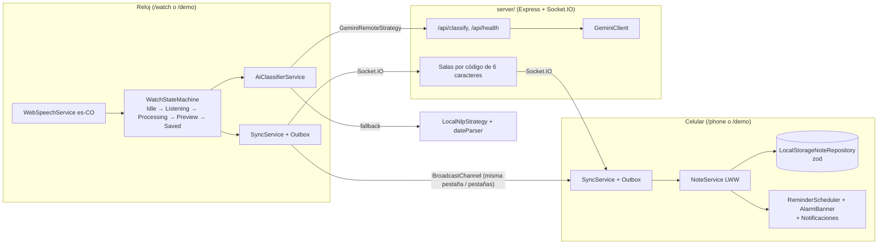

# FLUX — Captura de notas por voz (reloj + celular)

FLUX es un sistema de captura rápida de notas con dos interfaces sincronizadas:

- **Reloj** (estilo Wear OS, pantalla circular): dictas una nota, la IA la clasifica y, tras una vista previa con auto-guardado de 5 s, se envía al celular.
- **Celular companion** (estilo Android Material): recibe las notas en tiempo real, permite buscarlas, filtrarlas, completarlas y eliminarlas, y hace sonar las alarmas de los recordatorios.

La IA clasifica en **Tareas, Ideas, Recordatorios e Información** y extrae fechas relativas en español ("mañana a las 8 am", "en 10 segundos", "el viernes"). Usa **Gemini** a través del servidor y, si no hay API key o falla, un **clasificador local** que funciona siempre.



| Alarma en el celular (tema claro) | Reloj con QR de vinculación | Celular real |
|---|---|---|
|  |  |  |

---

## Arquitectura



```
src/
  app/          composición: bootstrap, rutas, páginas, fábricas de dispositivos
  core/         config, errors (AppError), events (EventBus), logger, router, types
  shared/       components, dom (h, icon, svg), http, i18n (es/en), storage, theme, utils
  modules/
    ai/         modelos, dateParser, estrategias (Gemini/Local), AiClassifierService
    capture/    SpeechService, CaptureModeService, WaveformCanvas, TextCaptureForm
    notes/      modelo + repositorio + NoteService + filtros + NoteCard/NoteList/chips/buscador
    sync/       transportes, Outbox, SyncService, PairingService, panel QR
    reminders/  ReminderScheduler, AlarmQueue, NotificationManager, AlarmBanner
    watch/      WatchStateMachine, estados, vistas por estado, carátula y marco
    phone/      PhoneComponent y secciones (header, composer, vinculación, marco)
    presentation/ barra de demo, 5 casos, escenario escalable, conector animado
server/src/     index, server, app, config, routes, sockets, schemas, services, middleware, errors
```

Ninguna vista accede al almacenamiento ni a la red: todo pasa por servicios. Los módulos se conectan en `src/app/` (raíz de composición). Por ejemplo, el módulo de recordatorios se monta con `mountReminders(host)` sin modificar el celular.

### Patrones usados

| Patrón | Dónde | Por qué |
|---|---|---|
| **Observer / EventBus tipado** | `core/events/EventBus.ts`; una instancia por dispositivo y un bus global de app | Desacopla módulos; dos dispositivos simulados en una misma página no comparten eventos internos. |
| **Strategy** (clasificador) | `GeminiRemoteStrategy`, `LocalNlpStrategy` en `AiClassifierService` | Motores intercambiables con fallback automático: Gemini → local. |
| **Strategy / Adapter** (transporte) | `LocalSyncTransport` (BroadcastChannel), `SocketSyncTransport`, `CompositeSyncTransport` | `SyncService` no sabe cómo viajan los mensajes; cambiar de canal no toca la lógica de cola. |
| **Repository** | `INoteRepository` + `LocalStorageNoteRepository` validado con zod | Aísla la persistencia; datos corruptos se descartan nota por nota. |
| **State** | `WatchStateMachine` + `IdleState`, `ListeningState`, `ProcessingState`, `PreviewState`, `SavedState` | Cada estado maneja sus comandos y libera sus timers y sesiones al salir; sin condicionales anidados. |
| **Composition Root / DI** | `src/app/devices/*`, `src/app/services.ts` | Las dependencias se inyectan, lo que permite tests sin navegador. |
| **Jerarquía de errores** | `AppError` y subclases (cliente y servidor) | Cada `code` se traduce a un mensaje claro en español. |

---

## Instalación

Requisitos: **Node 20+** (probado con Node 24) y npm.

```powershell
cd C:\Users\ivan2\Projects\flux-app
npm run setup          # instala dependencias del frontend y de server/
copy server\.env.example server\.env   # opcional: agrega tu GEMINI_API_KEY
npm run dev            # frontend (5173) + servidor (3001)
```

Abre <http://localhost:5173/demo>.

### Variables de entorno

**server/.env** (ver `server/.env.example`). La API key vive solo aquí y nunca en el frontend ni en el repositorio:

| Variable | Por defecto | Descripción |
|---|---|---|
| `PORT` | `3001` | Puerto del servidor (Vite lo usa como proxy). |
| `CORS_ORIGINS` | `http://localhost:5173,https://localhost:5173` | Orígenes permitidos (CORS y Socket.IO). |
| `GEMINI_API_KEY` | vacío | Sin key se usa el clasificador local. |
| `GEMINI_MODEL` | `gemini-2.5-flash` | Modelo de Gemini. |
| `GEMINI_TIMEOUT_MS` | `6000` | Tiempo máximo de respuesta de Gemini. |
| `RATE_LIMIT_WINDOW_MS` / `RATE_LIMIT_MAX` | `60000` / `60` | Límite de peticiones a `/api` por IP. |
| `BODY_LIMIT` | `10kb` | Tamaño máximo del cuerpo JSON. |

**Frontend** (opcional, `.env.local`, ver `.env.example`): `VITE_API_BASE_URL`, `VITE_SOCKET_URL`, `VITE_PUBLIC_ORIGIN`, `VITE_DEFAULT_LOCALE`, `VITE_SPEECH_LANG`, `FLUX_API_PROXY_TARGET`.

### Conectar Gemini

1. Crea una key en <https://aistudio.google.com/apikey>.
2. En `server/.env` escribe `GEMINI_API_KEY=tu_key` (y cambia `GEMINI_MODEL` si quieres otro modelo vigente).
3. Reinicia `npm run dev`. La barra de demo mostrará **"IA remota · Gemini"**; si la key falla, vuelve sola a **"IA local"**.

## Scripts

| Script | Qué hace |
|---|---|
| `npm run dev` | Frontend + servidor con `concurrently`. |
| `npm run dev:web` / `npm run dev:server` | Cada parte por separado. |
| `npm run dev:lan` | HTTPS en `0.0.0.0`, imprime las URLs con tu IP local y configura el QR. |
| `npm run lint` | ESLint (frontend, servidor y config). |
| `npm test` | Vitest del frontend y del servidor. |
| `npm run build` | `tsc` + build de Vite (PWA) + build del servidor. |
| `npm run emulator` / `npm run usb` | Prepara el emulador o un celular USB (`scripts/emulator.ps1`). |
| `npm run icons` | Regenera los íconos PWA. |

## Rutas

- **`/demo`**: reloj y celular lado a lado para el proyector, enlazados por BroadcastChannel (no necesita servidor).
- **`/watch`**: solo el reloj, a pantalla completa, con el código de 6 caracteres y el QR (`/phone?pair=CÓDIGO`).
- **`/phone`**: el companion a pantalla completa para el celular real o el emulador; se vincula por QR o escribiendo el código (ícono de enlace).

Si se pierde la conexión, el reloj encola las notas (se ve "En cola" y el contador) y las envía al reconectar, sin duplicados.

---

## Probar en emulador, USB y Wi-Fi

El micrófono, las notificaciones y el service worker exigen **contexto seguro**: `https://` o `http://localhost`.

### a) Emulador de Android Studio

```powershell
npm run dev            # en una terminal
npm run emulator       # en otra
```

El script arranca `Medium_Phone_API_37.0`, espera el arranque, ejecuta `adb reverse tcp:5173 tcp:5173` y `adb reverse tcp:3001 tcp:3001`, y abre `http://localhost:5173/phone` en Chrome del emulador.

- **Micrófono**: en el emulador, `…` (Extended controls) → **Microphone** → activa *"Virtual microphone uses host audio input"*.
- **Espacio en disco**: el emulador necesita varios GB libres en C:. El script usa `-partition-size 2047` para reducirlo. Si aun así falla con *"Not enough space to create userdata partition"*, libera espacio o mueve los AVD a otro disco con la variable `ANDROID_AVD_HOME`.

### b) Celular real por USB

Activa *Opciones de desarrollador → Depuración USB*, conecta el cable, acepta la huella y ejecuta:

```powershell
npm run dev
npm run usb            # adb -d reverse de 5173 y 3001 + abre /phone
```

### c) Celular real por Wi-Fi (HTTPS)

```powershell
npm run dev:lan
```

La consola muestra `https://<tu-IP>:5173/watch` y `https://<tu-IP>:5173/phone`. En el celular abre la URL, toca **Configuración avanzada → Continuar al sitio**: el certificado es local y autofirmado. Abre `/watch` en la laptop **usando la misma URL con IP** y escanea su QR con la cámara del celular.

### Lista de verificación

1. `npm run dev` corriendo; <http://localhost:5173/api/health> responde `{"status":"ok"}`.
2. En el dispositivo, `/phone` carga y el ícono de enlace aparece resaltado (sin vincular).
3. En la laptop abre `/watch` y anota el código de 6 caracteres.
4. En el celular toca el ícono de enlace, escribe el código → ambos muestran **Conectado**.
5. En el reloj dicta o escribe *"Recuérdame tomar agua en 10 segundos"* → la nota aparece en el celular y la línea del conector se ilumina.
6. En el celular toca la campana → acepta el permiso de notificaciones.
7. A los ~10 s suena la alarma, aparece el banner y la notificación del sistema. Prueba **Posponer** y **Completar**.
8. Instala la PWA: menú de Chrome → **Instalar app / Agregar a pantalla principal**. Abre desde el ícono: inicia en `/phone`.
9. Apaga el Wi-Fi o el servidor, guarda una nota en el reloj (verás "En cola"), restablece la conexión: la nota llega una sola vez.

---

## Guía de demostración (5 casos)

Abre <http://localhost:5173/demo> en el proyector. La barra superior tiene los 5 casos (1 clic cada uno), el interruptor de micrófono, el estado de la IA, el idioma y el tema.

1. **Recordatorio**: *"Recuérdame entregar el proyecto de bases de datos mañana a las 8 am"*. El reloj escucha, la IA lo marca como **Recordatorio** con la fecha de mañana a las 08:00 y a los 5 s aparece en el celular.
2. **Tarea**: *"Tengo que comprar los cables HDMI para el laboratorio de redes"*. Queda como **Tarea** con el título limpio "Comprar los cables HDMI…".
3. **Idea**: *"Se me ocurrió una idea: usar algoritmos genéticos para ahorrar batería en el reloj"*. Queda como **Idea**.
4. **Información**: *"El código de acceso al laboratorio de cómputo es 4829"*. Queda como **Información**.
5. **Alarma en 10 s**: *"Recuérdame tomar agua en 10 segundos"*. Se guarda y, unos segundos después, suena la alarma en el celular con banner, **Posponer 5 min** y **Completar**. Si diste permiso, también llega la notificación del sistema.

Extras para mostrar:
- En la vista previa del reloj prueba **Editar**: pausa la cuenta regresiva y reclasifica. **Cancelar** descarta la nota.
- Activa el micrófono (barra) y dicta una nota real. Sin soporte o sin permiso, el reloj pasa a entrada por texto.
- En el celular: buscador sin tildes ("cafe" encuentra "café"), chips con contador, completar, eliminar con confirmación y **+** para crear desde el celular.
- `Solo reloj` / `Solo celular` abren `/watch` y `/phone` para la demo entre dispositivos.
- **Reiniciar notas** limpia el celular antes de empezar.

## Seguridad

- La API key solo existe en `server/.env` y viaja en el header `x-goog-api-key`. No hay ningún campo de API key en la interfaz.
- zod valida el cuerpo de las peticiones, la respuesta de Gemini (en servidor y en cliente), los eventos de Socket.IO, los mensajes de BroadcastChannel y el almacenamiento local.
- Todo texto del usuario pasa por `sanitizeUserText` y se renderiza con `textContent`. ESLint prohíbe `innerHTML`.
- El servidor usa helmet, CORS con lista de orígenes, rate limit en `/api`, límite de cuerpo, límite de mensajes por socket y salas aisladas por código (un socket solo puede emitir en la sala a la que se unió).

## Calidad

- TypeScript strict (`noUncheckedIndexedAccess`), sin `any` y sin `console` fuera del logger.
- Pruebas: `dateParser`, `LocalNlpStrategy`, `AiClassifierService` (con fallback), repositorio, `NoteService`, filtros, `EventBus`, `Router`, i18n, tema, `SyncService` (cola, fusión y deduplicación), transportes, emparejamiento, `WatchStateMachine`, `ReminderScheduler`, casos de demo, API, Gemini y sockets del servidor.
- Accesibilidad: axe-core sin violaciones en `/demo`, `/phone` y `/watch` (claro y oscuro), foco visible, navegación por teclado (Escape cierra diálogos y cancela en el reloj) y `prefers-reduced-motion`.

Las decisiones técnicas están en [DECISIONS.md](DECISIONS.md).
